# I4F discharge: published results, 25–26 October 2026

**26 October run state:** the finite-water first-step case contacted the
pressure floor at .409998 s and saved at .410223 s. The uninterrupted
constant-density cold control ended at .434532 s with eighteen raw contacts.
The smaller-timestep finite-water comparison stopped at .383069 s after a raw
minimum of +677.757 Pa, below the 10 kPa floor. A warm-start
upwind fork saved a complete .460048 s checkpoint with no pressure-floor
contacts, then stopped at .481894 s on persistent pressure updates without
floor contacts. The warm fork does not establish a
full cold-history remedy. Caching the predictor Sp extended a matched warm
replay to .494225 s before a pressure-update stop. More outer iterations,
tighter temperature solves and the alternative pressure linearization did not
cure the cycle; a 25-microsecond warm timestep trial contacted the floor almost
immediately. [Controlled outcomes](pressure-coupling-comparison/outcomes.csv)
retain the different histories and terminal reasons. The
[source-cycle packet](pressure-source-cycle/summary.json) provides the actual
alternating cell trace, source-coefficient comparison and its limitations. The
[periodic interface verification](pressure-equilibrium/public-reproduction-smoke.json)
completed .1 s/1000 steps with roundoff-level uniform p/U/T errors, but does not
exercise the tank's compression sources. No complete credible discharge or validation result
has been produced. See
[live status](../../../docs/STATUS.md) for exact run identities and deadlines.
The [cell/iteration review](finite-water-floor-review.json),
[pressure-pass table](finite-water-floor-pressure-passes.csv),
[contact cells](finite-water-floor-cells.csv), and
[trace plot](finite-water-floor-pressure-passes.png) show the isolated last-pass
undershoot and two subsequent positive-pressure steps. Small final corrections
do not undo the pressure-floor operation.

**26 October numerical update:** the corrected-junction restarted constant-density
continuation stopped at .434224 s with negative intermediate pressure; geometry
correction alone did not resolve the instability. One pressure corrector and
tank-interface refinement also retained persistent outer updates. The separate
uninterrupted true-cold standard-source control saved at .434532 s after eighteen
raw pressure-floor contacts. The smaller-timestep finite-water cold comparison
also contacted the floor; it is an exploratory sensitivity, not a successful discharge. The
[frozen material packet](../../../experiments/i4f_physical_water_eos_reference/i4f-physical-water-eos-reference.json)
records equations, primary-source locators, assumptions and initial-mass effects.
The [corrected-flush finite-water input capsule](../../../cases/i4f_corrected_flush_finite_water_reference/README.md)
publishes the actual smaller-timestep dictionaries and their pre-launch hashes;
the native mesh and restart fields remain separate required inputs.
The [four recent failed trials](pressure-filling-diagnostic-outcomes.json) and
[comparison table](pressure-filling-diagnostic-outcomes.csv) retain actual stop
conditions, saved endpoints and source-metadata hashes. Pressure-floor cell
liquid support is not removed water mass.
The [runtime audit](finite-water-runtime-audit.json) verifies model selection and
density-weighted water inventory against the exact .05 s native checkpoint;
its later live-stage observation is a time-stamped snapshot, not a final result.
[Live status](../../../docs/STATUS.md) supersedes running-state statements below.

The [parser repair and full-log replay](parser-merge-replay.json),
[minimal patch](parser-merge-fix.patch), and [raw trigger](parser-merge-trigger.txt)
preserve the earlier operational-stop explanation without changing numerical
health thresholds. Successful parsing is distinct from convergence.

**Sealed-gas tank-to-nozzle pressure reference:** the
[per-tank JSON](sealed-gas-pressure-budget/pressure-budget.json),
[24-row CSV](sealed-gas-pressure-budget/pressure-budget.csv), and
[figure](sealed-gas-pressure-budget/pressure-budget.png) use the corrected
1.0/0.8 m geometry packet and explicit 12/13 bar absolute scenarios. For
12 bar, 22.5% headspace and n=1.4, full-bore priming leaves 3.478/3.771 bar;
the quasistatic sealed-gas relation reaches 1 bar after about 1.056/1.098 m3
nozzle-delivered volume per tank. This is not a maximum delivery or emptying
prediction. The n=1 case is an isothermal limit, n=1.4 an adiabatic-air
reference; neither is fitted. The .20–.25 headspace sweep holds tank water at
1.35 m3 and changes total assumed capacity from 1.620 to 1.6875 m3. The 0.8 m
variant reduces provisional downstream air storage by 41.335 L per tank, but
no CFD performance benefit has been established. The model assumes complete
purge of the initially air-filled downstream line for its post-priming gas
calculation, but does not model purge dynamics, losses, inertia, gravity,
venting, CO2, foam or heat-transfer rates; no value is identified with a CFD
probe. The package includes
[source/input snapshots and hashes](sealed-gas-pressure-budget/provenance/publication-package.json).

**Audit-output profile:** the matched
[exact-byte proof](pressure-audit-toggle/exact-byte-proof.json) and
[captured v2 record](pressure-audit-toggle/profile-window-result-v2.json)
show identical fourteen native fields plus `uniform/time` at .401007658722 s for
audit output on/off, in distinct files, after seven steps. The one sequential
pair used 51/42 solver ClockTime seconds. This is not a universal performance
claim. Future child helpers disable only detailed audit logging; the completed
warm continuation used this setting. The
[runtime profile](runtime-performance/runtime-profile-index.json) separates
wall time, calling-process CPU time, iteration counts and sampled output sizes.
The [full software check](runtime-performance/checks/make-check-20261026T153334Z/check-result.json)
and [post-merge checks](runtime-performance/checks/postmerge-20261026T154602Z/check-record.json)
record their distinct revisions and coverage.

**Early corrected-CFD comparison:** at .250021 s, mean water withdrawn per
tank is 62.581 L versus 62.210 L in the adiabatic reduced model (+.597%);
the two-valve flow sum per tank is .608803 versus .604200 m3/s (+.762%).
The [data and method](flush-early-cfd-model-comparison.json) and
[CSV](flush-early-cfd-model-comparison.csv) distinguish local headspace probes
from bulk model pressure and retain exact time-sampling conventions.
This is startup consistency through .25 s, before predicted mouth discharge.

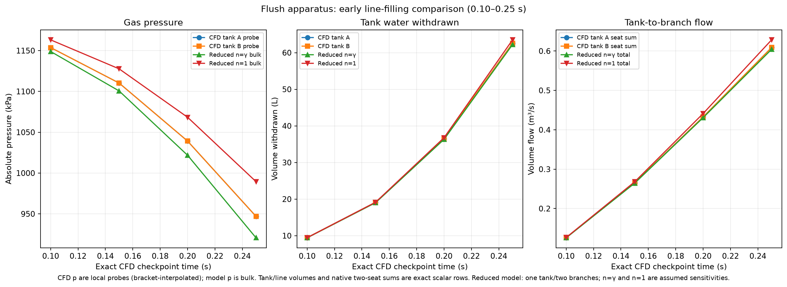

**Reduced model aligned to the corrected junction:** the
[comparison](flush-filling-model-comparison.json) and
[CSV](flush-filling-model-comparison.csv) use native tank/headspace inputs
and direct compact centerlines. Assumed adiabatic/isothermal gas expansion
gives mouth-water arrivals around .617–.625/.585–.591 s, respectively.
The modeled mean-level intake-crown endpoint is not emptying or established
gas breakthrough. Wet-feed/full-line volume differences of +.634/+2.081%
remain explicit; no loss or gas-law parameter was fitted to CFD.

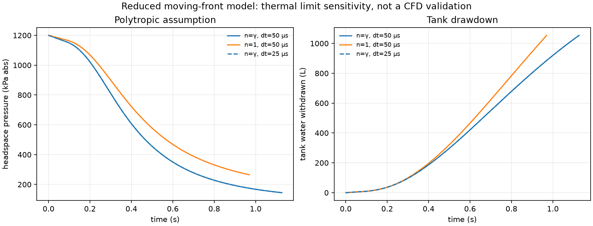

**Standard-source cold control:** bulk histories remain closely aligned with
the frozen-source reference through .4 s; nearest-row valve flux differences
are below .006%. The [comparison](stock-frozen-source-comparison.json) and
[CSV](stock-frozen-source-comparison.csv) retain exact time offsets and limits.
The uninterrupted true-cold trajectory ended at .434532 s with eighteen raw
pressure-floor contacts, before .46 s. The [14-cell review](stock-cold-pressure-contact-review.json),
[CSV](stock-cold-pressure-contact-review.csv) and
[pressure-correction trace](stock-cold-pressure-contact-trace.png) distinguish
that numerical event from the positive saved endpoint and from cavitation.
That first corrected-junction trajectory later failed; see the update above.

**Pipe/transition junction:** a source-to-native-mesh audit found an exposed
roughly 19 mm shoulder created by the old pipe overlap. The opt-in flush
junction removes it at all four branches, preserving tank and feed geometry.
The [geometry record](pipe-transition-join-summary.json) and
[section areas](pipe-transition-join-areas.png) document the correction.
The correction did not prevent the later pressure failure; its effect on a complete discharge remains unestablished.

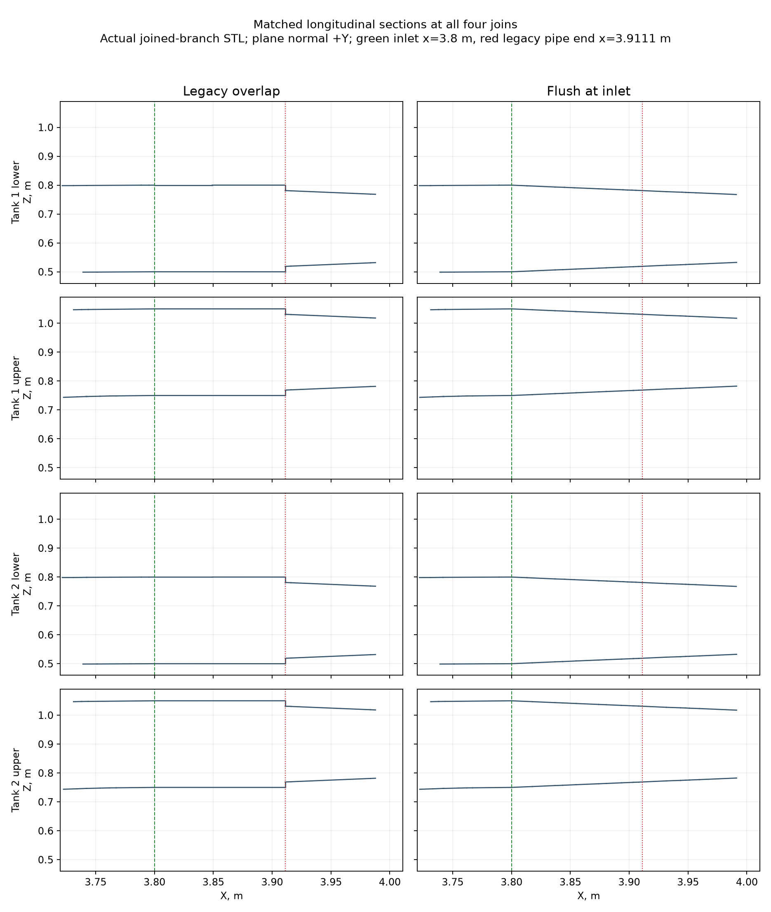

**Tank refinement now reaches .4 s:** the 456,954-cell case ends normally at
.399995 s, compared with the clean 299,248-cell state at .400087 s. Tank-A
gas-mass-weighted temperature changes from 261.207 to 254.920 K and pressure
from 654.125 to 642.040 kPa. Valve flow changes -1.04%, while tank withdrawal
changes -1.107 L (-.584%). The exact 91.4-microsecond time offset and .883%
initial gas-capacity difference remain explicit; no fields are interpolated.
The [analysis](tank-interface-terminal-comparison.json) and
[native history](tank-interface-terminal-history.csv) show thermal sensitivity,
not mesh convergence or a demonstrated heat-transfer mechanism. The refined
run has no pressure-floor events through this endpoint; it does not test the
later .41–.44 s failure interval.

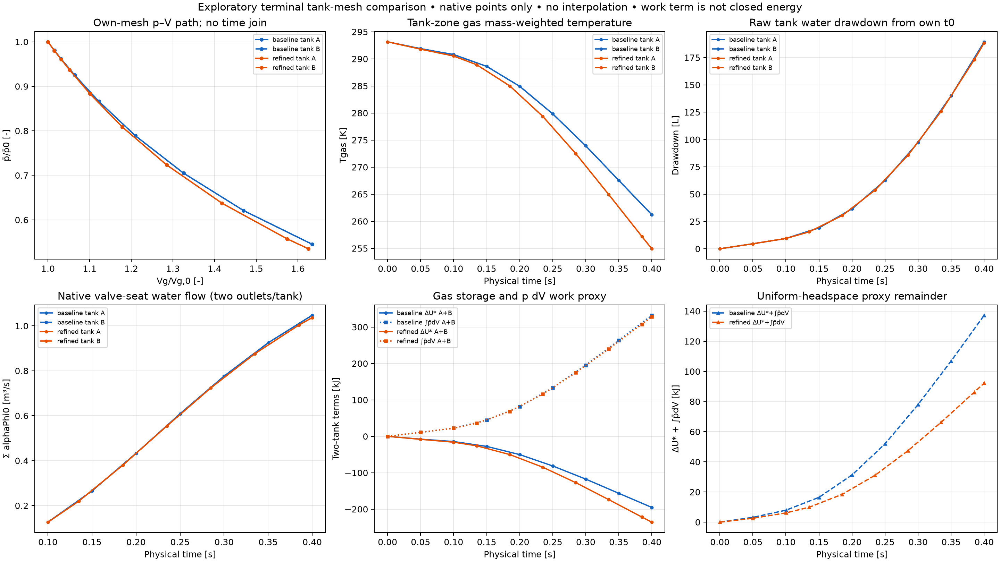

**New controlled thermal diagnostic:** uniform refinement in a sealed
water–air withdrawal test reduces pressure error against adiabatic expansion
from **6.66% to 1.92%**. Both phase meshes change together; thermal diffusion
is suppressed and turbulence is disabled. This demonstrates numerical bias
in that diagnostic without establishing the apparatus cause. The
[analysis](gas-layer-grid-sensitivity.json),
[summary](gas-layer-grid-summary.csv) and
[figure provenance](gas-layer-grid-figure-provenance.json) record the
different solver/numerical settings and exact native-field checks.

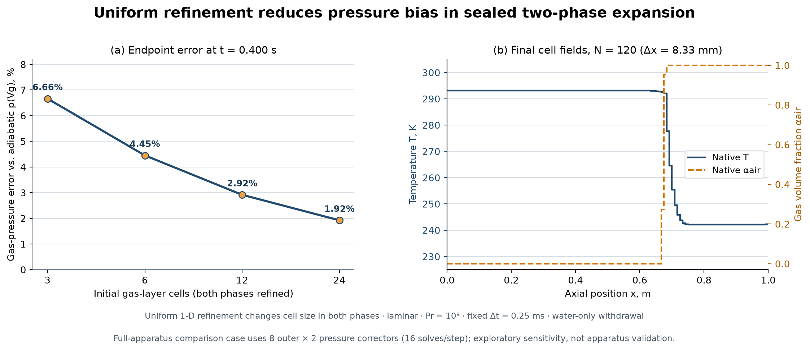

**First apparatus tank-refinement comparison:** at the exact same .050021 s
native state, local refinement from about 50 to 25 mm barely changes drainage
and valve flow, while gas temperature is .089 K lower and mixed-cell gas-volume
share falls from 15.57% to 12.56%. The meshes have .883% different initial gas
capacities; this is one early snapshot, not convergence. See the
[figure](tank-interface-startup-comparison.png),
[native metrics](tank-interface-startup-comparison.csv), and
[analysis with source hashes](tank-interface-startup-comparison.json).
The [extension through .100021 s](tank-interface-time-series.png) shows a .269 K
gas-temperature difference with little flow/inventory change; its
[data](tank-interface-time-series.json) include unmodified phase-fraction bounds
and [CSV](tank-interface-time-series.csv). This remains startup sensitivity.

**Pressure failures are localized:** the
[corrected contact review](pressure-contact-review.json) recovers rank-prefixed
raw cells in the rising bend for momentum relaxation and the stock-source
restart. The [momentum-relaxation cells](u-relax-pressure-contact-cells.csv)
and [stock-source cell](stock-alpha-pressure-contact-cells.csv) reconcile with
global raw minima. Positive final saved pressure does not clear an earlier
raw-floor contact; none of these tests establishes a complete discharge.

**Gas energy accounting:** the [storage/work plot](headspace-pv-energy-proxy.png)
and [analysis](headspace-pv-energy-proxy.json) quantify a +137.319 kJ two-tank
`delta(U*) + integral(pbar dV)` remainder through .400087 s. This is a
uniform-headspace work proxy, not measured heat or closed CFD energy balance.
The refined curve ends earlier, at .284932 s. The [CSV](headspace-pv-energy-proxy.csv)
labels gas inventory changes separately from conservation errors.

[Watch corrected-source pipe filling through 0.443669 s, 10× slow](corrected-source-cutaway-through-0p443-10x.mp4)
or the [all-four-branches outlet view](corrected-source-outlets-through-0p443-10x.mp4).
The 4.874-second movies show ten actual saved states, including initialization,
with no temporal field interpolation. The final frame is held for the preceding
saved interval and identifies the pressure-iteration diagnostic stop. This is
incomplete discharge, with no alpha >= .5 exterior water at the endpoint.
The [movie record](corrected-source-movie-through-0p443.json),
[checkpoint hashes](corrected-source-movie-checkpoints.json) and
[timing proof](corrected-source-movie-timing.json) document the sequence.

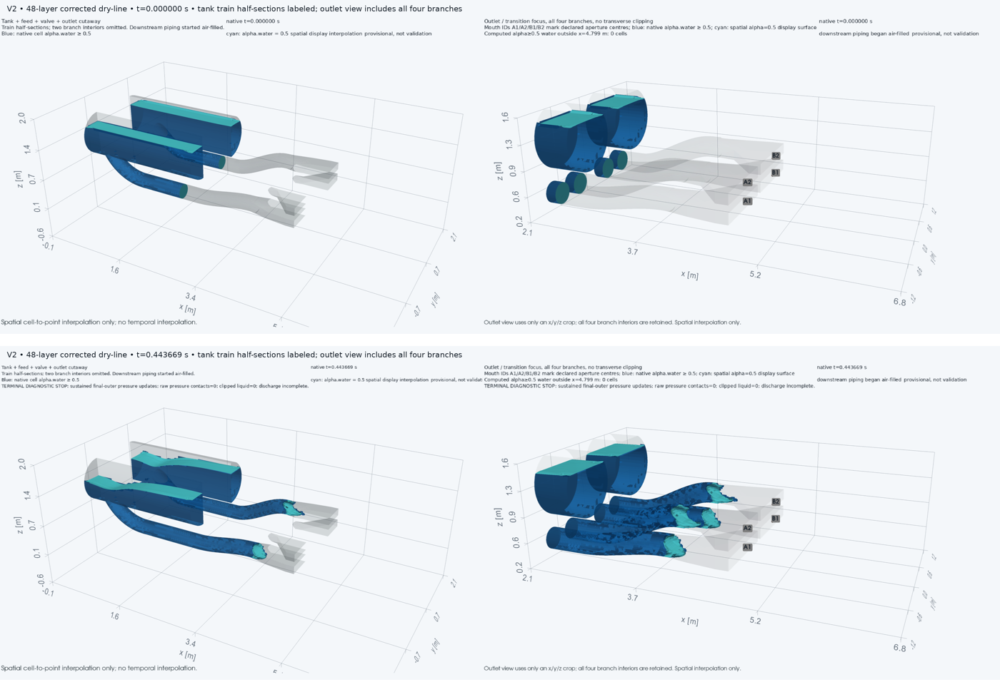

The newer corrected-source case is shown below at **0.350114 s**, on its
299,248-cell mesh. Blue marks native cells with water fraction at least .5;
cyan is the spatially interpolated .5 display surface. The right view retains
all four branches; the left uses labeled half-sections. At this saved time,
the mouths contain no resolved water at that threshold: this shows pipe
filling, not an exterior discharge sheet.

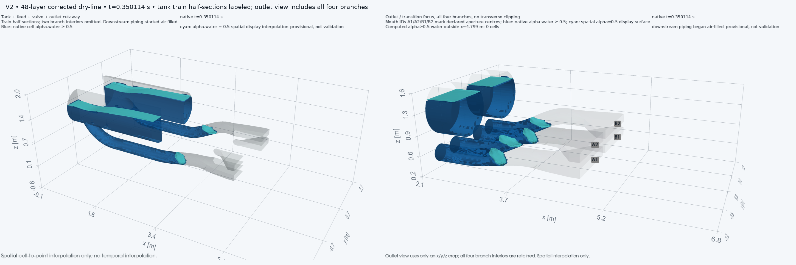

The [native-field render record](corrected-source-preview-0p350.json) includes
checkpoint hashes and cell-address mapping checks; the
[backend record](corrected-source-preview-backend.json) verifies CPU/Mesa
rendering. The run subsequently saved at .443669 s after pressure corrections
stopped settling; its .8 s movie watcher ended without reaching that milestone.
The shorter terminal movie above is now available. A complete verified
discharge remains pending.

The [saved-field thermal audit](corrected-source-temperature-audit.json)
locates the .40 s temperature minimum of 245.66 K in tank gas, while the
lowest-pressure line cell is near 293 K. Bulk water stays near 293 K; only
.0592 g of water is assigned a temperature below 273.15 K, all outside
cells with water fraction >= .99. The
[phase-mass distributions](corrected-source-temperature-distributions.png),
[regional data](corrected-source-temperature-zones.csv) and
[extrema](corrected-source-temperature-extrema.csv) distinguish gas cooling
from water cooling. This is a one-temperature model; the audit does not close
the energy budget or establish physical interphase heat transfer.

The [comparison through .400087 s](corrected-source-model-comparison.json)
shows close tank-water histories but a growing pressure difference: CFD is
46.60 kPa above the reduced model at the endpoint, alongside a warmer gas
state. Tank-A withdrawal differs by 2.480 L; the initial 1.592 L equivalent-feed
volume mismatch is recorded separately. The .35–.40 s valve-flow mean differs
by about 2.25%, while endpoint differences reach 5.20–6.06% by valve.
Connected-front locations depend on the stated water-fraction threshold and
are not an unqualified first-water measurement. The
[checkpoint table](corrected-source-model-checkpoints.csv),
[flow bins](corrected-source-model-flow-bins.csv) and
[connected fronts](corrected-source-model-fronts.csv) retain those definitions.

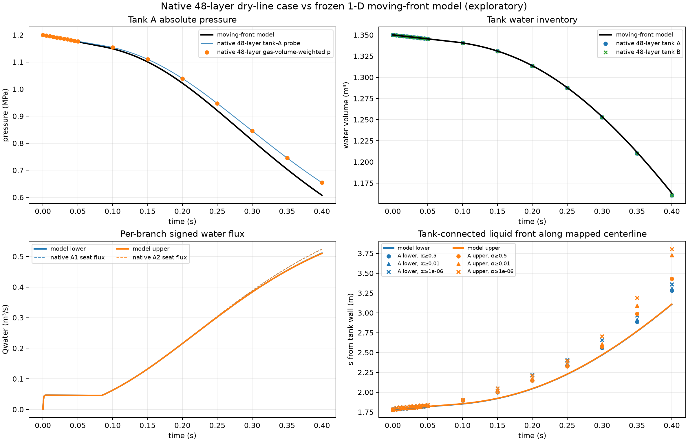

[Watch the earlier air-filled compact startup, 10× slow](current-air-filled-cutaway-10x.mp4)
or its [outlet view](current-air-filled-outlet-10x.mp4). These show pipe filling
through **0.200021 s**, with downstream air still present and no resolved sheet
outside the mouths. Six saved states are held at their actual timing; the
3-second clip includes a 1-second endpoint hold and no field interpolation.
The [movie manifest](current-air-filled-movie-manifest.json) records the inputs.
This uses the original partly wetted valve-source treatment. The corrected
279,536/299,248-cell source-resolution cases are newer; their long-run movie is
pending. Filenames are retained so existing links continue to work.

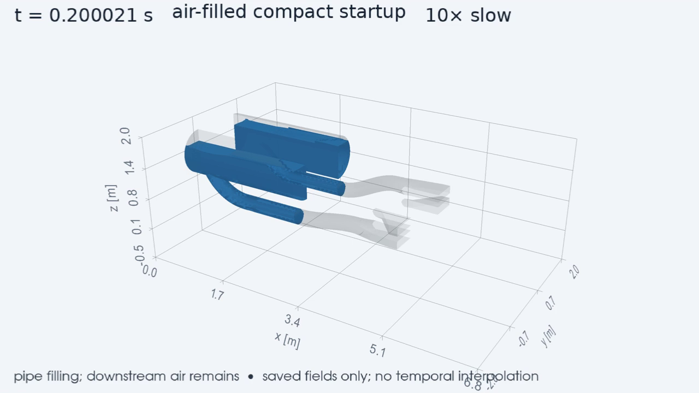

**Initial-state correction:** the user confirms that passages downstream of
the valves initially contain air. The earlier tank-cutaway movies listed below
and liquid-full-line comparisons preserve the primed-line assumption. Those
primed results do not show the confirmed startup. The earlier 269,680-cell air-filled compact baseline
established that startup. Its [native initial-state image](current-air-filled-initial-state.png)
shows 1.350 m3 in each tank, with another .25106/.25111 m3 in wetted upstream
feeds and air downstream of the assumed x=2.25 m valve planes. The image shows
initialization, not a discharge result. The rectangular mouths are at x=4.8 m.

The portable [moving-front model](air-filled-moving-front-model.json) and its
[timestep comparison](air-filled-moving-front-model-dt.json) predict first
mouth water near .612/.620 s, conditionally on a full-bore front. The
[thermal sensitivity](air-filled-model-thermal-sensitivity.json) advances those
times to .580/.587 s for isothermal gas and changes intake-crown timing by 14%.
These are one-tank/two-branch model results, not measured discharge or emptying.
The [native gas-state diagnostic](air-filled-gas-apparent-exponent.json) and
[data](air-filled-gas-apparent-exponent.csv) give an apparent expansion exponent
near 1.24 by .20 s, versus dry-air gamma near 1.40. This is an output diagnostic,
not a fitted input or a measured heat-transfer rate; energy closure remains open.
Run the model from the [frozen input packet](../../../experiments/i4f_filling_reference/inputs-manifest.json)
using `.venv/bin/python scripts/run_i4f_filling_network.py --max-time 1.3`.

The [CFD timestep comparison](air-filled-timestep-comparison.json) separates
common-time scalar interpolation from field snapshots at slightly different
times. The [initial-fill comparison](air-filled-initial-fill-comparison.json)
and [CSV](air-filled-initial-fill-comparison.csv) retain the different initial
water inventories. The [valve-source audit](air-filled-valve-zone-audit.json),
[plot](air-filled-valve-zone-audit.png) and
[inventory comparison](air-filled-valve-inventory-comparison.csv) identify an
early model/CFD mismatch: the distributed CFD resistance initially overlaps
water and air, while the reduced model applies a full liquid valve loss. A
separate source-placement trial is testing that mechanism without fitting Cd.
Its [first exact-time result](air-filled-valve-source-comparison.json) and
[CSV](air-filled-valve-source-comparison.csv) show 12.1% less tank drawdown at
.05 s with resistance wholly upstream of the initial front, preserving its
fully wet integral. This explains part of the model/CFD gap; later apparatus
sensitivity is still running. The [comparison through .200021 s](air-filled-source-history-comparison.json),
[data](air-filled-source-history-comparison.csv) and
[plot](air-filled-source-history-comparison.png) show a sign reversal:
thin-source tank-A withdrawal changes from .79 L less at .05 s to 3.08 L
more at .20 s. At .20 s its gas pressure is 11.85 kPa lower and its
alpha-water >= .5 front is about .15 m farther along the pipe. The original
source is already fully wetted by .15 s. Both fronts remain upstream of the
transition; this does not establish a corrected physical valve model.

The [direct resistance benchmark](valve-resistance-duct-results.json) and
[case table](valve-resistance-duct-cases.csv) isolate a numerical contribution:
for a .30 m scalar-resistance reach, reducing axial cell size from 25 to
6.25 mm lowers analytical steady-flow error from 6.34% to 1.38%. A .10 m
reach gives 27.66% and 5.02%, respectively. All four runs end normally with
native inlet/outlet flux closure; matching the integrated force alone does
not ensure the correct flow rate. This all-water, gravity-free slip duct tests
the scalar closure, not the real butterfly valve or apparatus. No fitted
discharge-coefficient correction is applied.

The [completed 12.5/6.25 mm apparatus comparison](air-filled-valve-band-axial-comparison.json)
and [native histories](air-filled-valve-band-axial-comparison.csv) retain a
strict **HOLD**: the first two timesteps exceed the 2% pointwise target.
Endpoint flow differs about 1.50%, and tank-A withdrawal is 4.66391 versus
4.59423 L, close to the reduced model's approximately 4.57 L. Both cases
ended normally at .050021 s without pressure-floor contacts. The longer
fine run is explicitly exploratory; this does not establish mesh independence
or hardware validation.

The next downstream-resolution candidate has **881,431 cells**, retaining
the fine valve band while refining the bend, mouth and adjacent exterior.
The [native spacing comparison](downstream-refinement-resolution.json) and
[data](downstream-refinement-resolution.csv) show approximately twofold
refinement in all three directions at the mouths. The
[preparation record](downstream-refinement-preparation.json) records all nine
configured quality checks passing, alongside 11,521 concave cells reported
by the separate optional geometry diagnostic. Remeshing changes line volume
by about .45%; it is not an exact subdivision of the old mesh. This candidate
has not yet supplied a CFD resolution comparison.

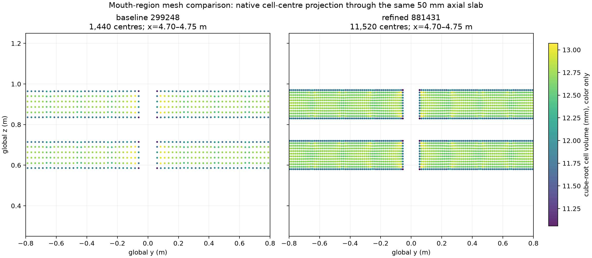

The image projects cell centers through a 50 mm axial slab, rather than
showing an exact face section; color gives cube-root cell volume, not pitch.

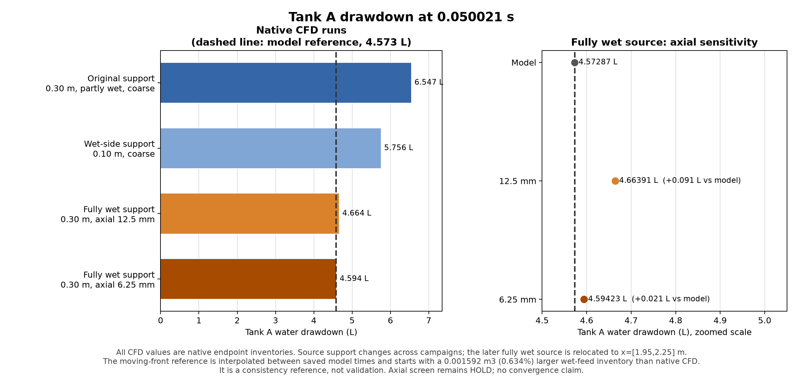

The [figure data](air-filled-drawdown-source-grid.csv) and
[source record](air-filled-drawdown-source-grid.json) preserve actual endpoint
times and the bracket-interpolated model reference. The model's initial wet-feed
volume is .634% larger than the native CFD value.

The [opening follow-up](valve-resistance-opening-comparison.json) and
[table](valve-resistance-opening-comparison.csv) give analytical flow errors
of .645%, .0162% and .00414% at constant opening fractions .02, .5 and 1,
using 3.125 mm axial cells in a shorter duct. The minimum-opening transfer
changes both domain and resolution relative to the first benchmark. Smoothing
the coarse source lowers its error to 3.13%, missing the working 2% target.
The aggregate run hit its wall cap during the full-open arm; its saved fields
and native flux plateau support the reported comparison, not completion of
its original .25 s horizon. Declared versus executed output-interval differences
are preserved in the JSON.

The compact geometry generator now supports both
[horizontal](compact-horizontal-tank-geometry.png) and
[vertical](compact-vertical-tank-geometry.png) tank axes. Their
[horizontal connection section](compact-horizontal-tank-connections.png) and
[vertical connection section](compact-vertical-tank-connections.png) were
inspected. The records ([horizontal](compact-horizontal-tank-geometry.json),
[vertical](compact-vertical-tank-geometry.json)) state the provisional placement,
equal vessel capacities and branch-intersection checks. These are geometry
comparisons; no vertical-tank performance result is claimed.

[Watch the 3D tank cutaway video, 10× slower](tank-cutaway-10x.mp4).
[Alternate outlet-focused render, same computed sequence](outlet-reference-10x.mp4).

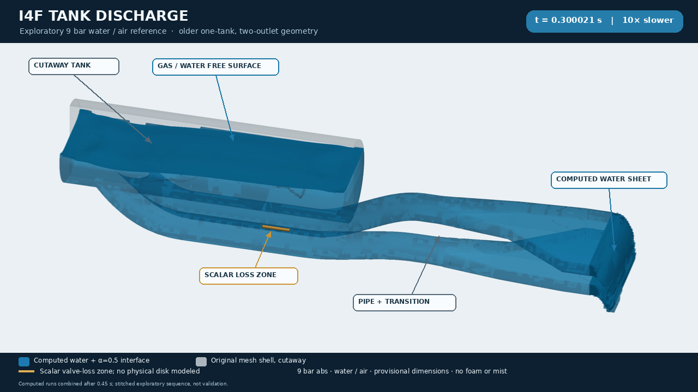

The video shows thirteen computed states through 0.560717 s of the older,
provisional **one-tank/two-outlet, 9 bar absolute water/air reference**. It is a
partial discharge, with a numerical-run seam disclosed in the image and
[movie manifest](cutaway-movie-manifest.json). It does not depict the new
two-tank apparatus or a complete emptying.

The updated apparatus has two tanks and four outlets. Its parameterized,
provisional reconstruction is shown below; original user CAD and photograph
remain unchanged under `docs/`.

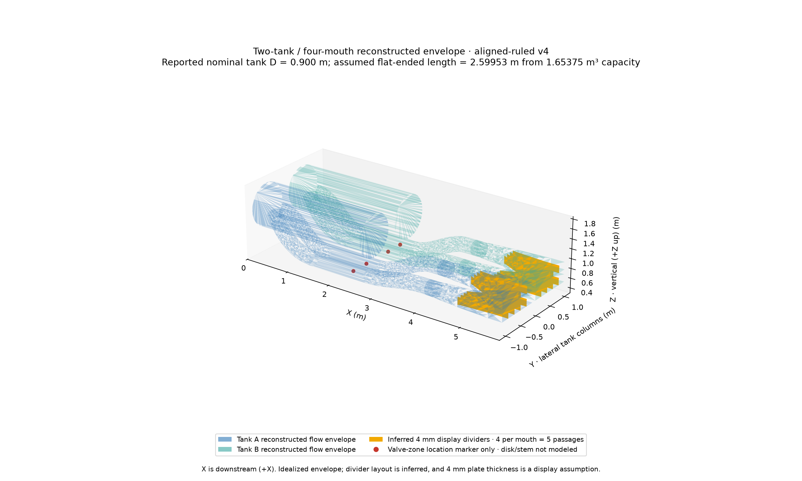

[Updated tank cutaway](current-tank-cutaway.png) ·
[User-reported hardware record](../../../experiments/i4f_hardware_notes_20261024.json)

An earlier 1,779,258-cell CFD case completed **0.005021 s of startup** with a saved
restart and no recorded pressure-floor contacts. This is not a useful discharge
interval or hardware validation. See [startup summary](current-startup-summary.json)
and [early model comparison](startup-model-comparison.png). Tank pressure
drawdown and inventory agree closely with the reduced model. The
[native control-volume audit](native-cv-endpoint-flux.json) independently recovers
about .08714 m3/s per tank from both water inventory loss and native face flux;
the sampled mouth plane reports about .068 m3/s. That distinct sampled-plane
gap remains unresolved and must not be hidden by adding downstream storage.
Both models use the same nominal valve-opening law and minimum
opening; the discrepancy is not evidence of a different prescribed aperture.

The later reservoir-boundary fine run completed **0.050021 s** normally, with
all native restart fields and no pressure clipping. The matched
[coarse/fine startup comparison](current-startup-grid-comparison.json),
[metrics](current-startup-grid-comparison.csv) and
[plot](current-startup-grid-comparison.png) show 403 Pa headspace-probe pressure
difference (0.034%) and 2.44% less tank drawdown on the fine mesh. Sampled
mouth-plane mean water fraction differs more: 0.944 fine versus 0.970 coarse.
Native headspace capacities differ by about 1%, and the coarse mesh retains two
quality failures; this is nominal-geometry startup sensitivity, not formal
convergence or evidence of later sheet accuracy.
The [native thermal comparison](current-startup-thermal-grid.json),
[metrics](current-startup-thermal-grid.csv) and
[plot](current-startup-thermal-grid.png) show that mixed cells carry 19.94% of
coarse tank-gas volume versus 12.69% fine at .05 s. Some difference is already
present in the initial interface representation (14.34% versus 11.37%).
Gas-mass-weighted shared temperatures differ by only .055 K, but probe
agreement alone does not establish the same interface partition or a separately
conservative gas-energy calculation.

The older [pressure-floor comparison](pressure-floor-comparison.png) found
nearly identical endpoint bulk outputs at 10/5 kPa floors, but the
[gas-field audit](older-case-gas-extrema.png) revealed approximately 1490 m/s
gas speed and a separate 652 K gas-temperature maximum near the ambient opening.
A matched pre-contact pair on that same older one-tank/two-outlet reference
compared its static ambient treatment with a 100 kPa absolute, 293.15 K
compressible reservoir on the three external patches. At the matched endpoint,
global maximum speed changed from 1162 to 67 m/s and global maximum temperature
from 495.5 to 293.3 K; the latter maximum is gas in the static arm and liquid in
the reservoir arm. Tank-zone pressure, sampled mouth flow and phase ledgers
remained close under the fixed original time-step schedule. A simple Courant
estimate suggests 22.35× time-step headroom for the reservoir condition, but
this is not measured runtime speedup. These are boundary-sensitivity results,
not validation of ambient coupling or the updated four-outlet hardware. See the
[pair evidence](ambient-reservoir-pair-r2-evidence.json),
[plot](ambient-reservoir-pair-r2.png), and matched
[boundary](ambient-reservoir-pair-r2-matched-boundary-history.csv) and
[bulk](ambient-reservoir-pair-r2-matched-bulk-history.csv) histories. Exact
tested patch-only dictionaries and provenance are in the
[reservoir BC verification folder](../../../experiments/openfoam/i4f/reservoir_bc_verification/tested-ambient-patches/manifest.json).

[Reduced-model scenarios](reduced-model-scenarios.png) cover declared headspace,
pressure and polytropic sensitivities. Their stop is a mean-level intake event,
not a five-second discharge or measured gas breakthrough.

An ongoing 303,108-cell four-outlet continuation has a saved native checkpoint
at 0.200021 s on its way toward 0.8 s; the mesh retains two configured
face-decomposition tetrahedron-quality failures, so results remain exploratory.
The [matched timestep comparison](current-timestep-comparison.json)
and [metrics](current-timestep-comparison.csv) cover only the first
0.05 s (0.25 versus 0.125 ms), not full convergence. The
[CFD/reduced-network plot](current-reduced-network-comparison.png),
[CSV](current-reduced-network-comparison.csv), and
[JSON](current-reduced-network-comparison.json) use complete mouth
profiles through 0.100021 s; native scalar histories continue to 0.167021 s.
All four mouths exceeded 5% gas area for three
samples from 0.060021 to 0.070021 s, but sampled signed gas flow was negative;
this does not identify gas delivered from the headspaces.

At 0.200021 s, the [native headspace EOS summary](current-headspace-state.json)
reports per tank about 1.03844 MPa volume-weighted gas pressure and 284.905 K
mass-weighted temperature; the local probe reads 1.038412 MPa and 281.357 K.
Pure-gas and mixed-cell temperatures average 282.475 K and 291.847 K,
respectively, showing the effect of spatial and phase weighting. The reported
pV/(gamma−1) change is storage only, not a global energy balance. See the
[headspace table](current-headspace-state.csv) and
[geometry comparison](current-geometry-validation.json). The portable
geometry generator and its fixed horizontal +X layout are documented in the
[geometry source README](../../../scripts/i4f_four_outlet_geometry/README.md).

The [shortened outlet layout comparison](shortened-outlet-layouts.png),
[geometry table](shortened-outlet-layouts.csv), and
[comparison metadata](shortened-outlet-layouts.json) show the provisional CAD
layout now generated by default: no added post-rise straight and a 1.0 m
transition-and-mouth train. The 0.8 m train is a shorter sensitivity; the older
0.2 m straight plus 1.8 m train remains the explicit reference. These are
geometry-only alternatives. All simulated fields and movies above still use
the older layout, and no CFD has been run for either shortened layout. The exact
BREP downstream line volume is 0.88054/0.68645/0.64498 m³ per tank (two
branches) for the reference/1.0 m/0.8 m layouts. If all four branches are
primed, the 1.0 m layout reduces potential line-water inventory by 388.19 L
total across both tanks versus the reference. Full priming remains unconfirmed;
line inventory is separate from tank water.

The native 0.200021 s [true-grid diagnostic cutaway](current-fourmouth-cutaway.png)
and [outlet detail](current-fourmouth-outlet-detail.png) show whole-cell
alpha.water ≥ 0.5 bulk with an interpolated alpha.water = 0.5 display contour;
the visible blockiness reflects the mesh cells. The external native-water
cell-centre extent reaches x ≈ 5.96 m, inside the 7.8 m domain end. These are
diagnostic snapshots; [render metadata](current-fourmouth-render-metadata.json)
records their field mapping and display thresholds.

The current long-geometry prefix is also available as a [10× full cutaway
video](current-fourmouth-cutaway-10x.mp4) and [10× outlet-focused
video](current-fourmouth-outlet-10x.mp4). Both use the long-outlet reference
geometry from the native CFD case, with an ordinary same-model restart; they
do not use the newer short-outlet candidate. The sparse saved states span
0–0.349936 s, followed by a 1 s endpoint hold at 24 fps. This is a
quality-limited partial-discharge prefix, not a completed discharge or
validation result. The rendering adds no foam or synthetic droplets and does
not interpolate fields between saved physical times. See the [movie manifest](current-fourmouth-movie-manifest.json)
for source hashes and display details.

Small JSON/CSV results accompany the figures. [Publication manifest](publication-manifest.json)
records source paths and byte hashes. Raw native fields, full logs and restart
bundles remain local under ignored `results/runs/`; these files are selected
outputs, not a complete transferable CFD case.
