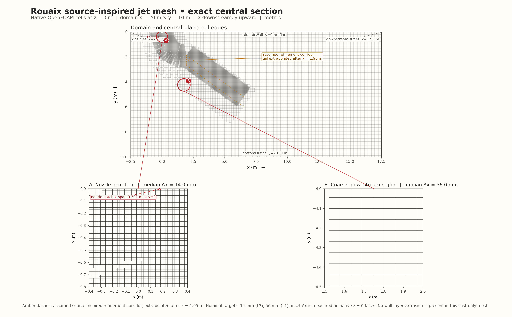

# Rouaix mesh plate



The plate shows the qualified 10,099,265-cell source-inspired mesh in its exact
central `z = 0 m` plane. It includes the full 20 m × 10 m x–y domain and
callouts into the 14 mm near-nozzle and 56 mm downstream mesh regions. The
upper boundary is the mesh's flat `aircraftWall`; no curved roof was added.

## Exported figures

- [PNG, 3900 × 2418 px](rouaix-mesh-z0-plate.png)
- [PDF](rouaix-mesh-z0-plate.pdf), with rasterized cell edges and vector labels,
  arrows and axes

The domain labels use native patch coordinates: `gasInlet` at `x = −2.5 m`,
`downstreamOutlet` at `x = 17.5 m`, `bottomOutlet` at `y = −10 m`, and the flat
`aircraftWall` at `y = 0 m`. The native nozzle patch is centred at `(x, y) =
(0, 0) m`; its x-span at the outlet plane is 0.39106 m. The full span narrows
from `z = [−8, 8] m` at the bottom to `z = [−3.5, 3.5] m` at the wall.

Amber dashed lines mark the source-inspired assumed refinement corridor. Its
tail beyond `x = 1.95 m` is extrapolated; this is a mesh guide, not measured
device geometry or a computed water plume.

## Exact section and measured spacing

The final plate is built from the binary native internal faces whose vertices
all satisfy `abs(z) ≤ 1e−12 m`. It contains 94,837 native faces and 191,470
unique in-plane edges, with no duplicate face geometry. The projected face
areas sum to 199.99999999999957 m², matching the 200 m² cross-section to a
relative residual of `−2.13e−15`. Edges are deduplicated by their actual native
point-label pairs.

`Δx` labels report the median length of unique native face-edge segments within
each inset. The recorded P10–P90 values show the local spread:

- Nozzle near-field, `x = [−0.4, 0.4] m`, `y = [−0.8, 0] m`: 3,189 native
  faces, 6,344 unique edges; median 13.967 mm, P10–P90 13.966–14.045 mm.
- Downstream coarse region, `x = [1.5, 2.0] m`, `y = [−4.5, −4.0] m`: 81
  native faces, 162 unique edges; median 56.023 mm, P10–P90 55.866–56.180 mm.

These medians agree with the nominal L3 and L1 targets of 14 mm and 56 mm.
They are local native-face measurements, not a formal cell-quality or
grid-convergence assessment. The cast-only mesh has no wall-layer extrusion.

## Why the first preview was replaced

An initial VTK `vtkCutter` at exactly `z = 0` created irregular closed loops.
The native audit showed that `z = 0` is already an exact internal-face plane:
94,837 native faces tile the full section. Direct native-face extraction
found no duplicate polygons and the correct 200 m² area. A VTK cut at `z =
±1e−6 m` also returned 94,837 polygons, while its exact `z = 0` run returned
119,288 polygons and 1,378 native cells emitted multiple cut polygons. In the
first preview's coarse ROI, a representative polyhedron cell (global ID
587633; volume `1.7875e−3 m³`) has a native coplanar face spanning
`0.11173 × 0.11236 m`; VTK's z=0 polygon for that cell spanned
`0.06902 × 0.11236 m` and did not match the native face. The offset audit
records the cell bounds and the native face match check. The first
VTK-rendered plate is retained as a superseded attempt in
`results/runs/rouaix-mesh-plate-20261028/staging/`; it is not the exported
figure. The final PNG and PDF use native internal faces and their original
point labels directly.

The native cut audits are in
[`native-z0-face-audit.json`](native-z0-face-audit.json),
[`vtk-cutter-z0-audit.json`](vtk-cutter-z0-audit.json), and
[`vtk-cutter-offset-comparison.json`](vtk-cutter-offset-comparison.json).
The offset audit maps the largest diagnostic cut polygons to native cell IDs,
types, centres, volumes and bounds. It found no coincident duplicate polygons;
the exact-plane output had additional/multiple cell cuts relative to both
offset planes and the native face tessellation. Direct face extraction removes
that coplanar-plane ambiguity from the exported figure.

## Inputs and reproduction

The mesh is the final-cast-only candidate at
`results/runs/rouaix-matched-mesh-mac-20261025/final-cast-only-transfer-core/constant/polyMesh`.
ParaView 6.1.1 / VTK 9.6.2 read its `internalMesh`; all 10,099,265 native cell
centres and volumes matched the retained geometry cache exactly (maximum
absolute differences 0). The renderer then reads exact `z=0` native faces
from the binary polyMesh files. The qualified mesh is source-inspired, not
source-exact or a paper validation result.

The figure receipt, input hashes, ROI measurements, checks and resource record
are in [`mesh-plate-provenance.json`](mesh-plate-provenance.json). The source
scripts and their reused native-order reader are in
[`source-helpers.tar.gz`](source-helpers.tar.gz), with member hashes and the
exact run command in [`source-helpers-manifest.json`](source-helpers-manifest.json).
The mesh and geometry cache are referenced in place instead of copied into the
summary.

Run from the repository root:

```sh
VTK_SMP_MAX_THREADS=4 OMP_NUM_THREADS=1 OPENBLAS_NUM_THREADS=1 MKL_NUM_THREADS=1 \
  .venv/bin/python scripts/run_local.py --threads 4 --timeout 1200 -- \
  /Applications/ParaView-6.1.1.app/Contents/bin/pvpython \
  results/runs/rouaix-mesh-plate-20261028/render_mesh_plate.py

VTK_SMP_MAX_THREADS=2 OMP_NUM_THREADS=1 OPENBLAS_NUM_THREADS=1 MKL_NUM_THREADS=1 \
  .venv/bin/python scripts/run_local.py --threads 2 --timeout 1200 -- \
  /Applications/ParaView-6.1.1.app/Contents/bin/pvpython \
  results/runs/rouaix-mesh-plate-20261028/audit_vtk_native_cell_identity.py
```

The renderer used ParaView to load the reconstructed mesh and compare cell arrays against the native order. The final section came from native face connectivity and Matplotlib Agg; no ParaView `Render` or `SaveScreenshot`, OpenGL, GPU, field interpolation, cell smoothing, or geometry edits were used. The additional cell identity check used a bounded CPU ParaView read plus direct native face parsing. The run completed in 12.56 s at 3.35 GiB peak RSS.
The pre-run checks reported 10 effective CPUs, 24 GiB physical memory, about
64% free under `memory_pressure`, and 151.7 GiB free disk.
