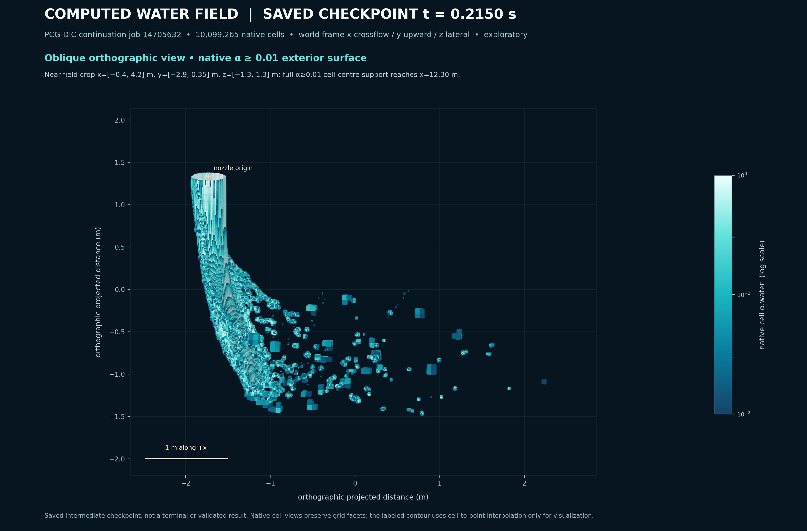
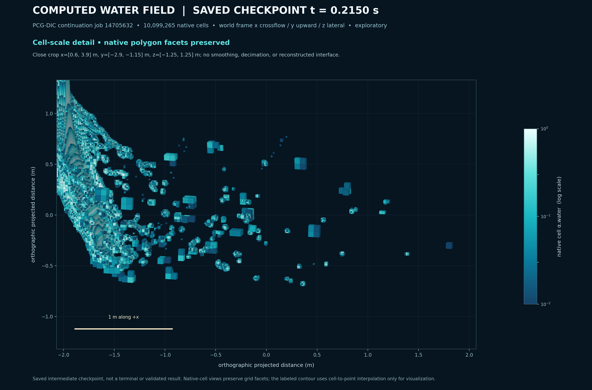
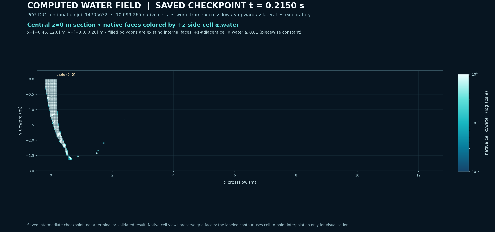
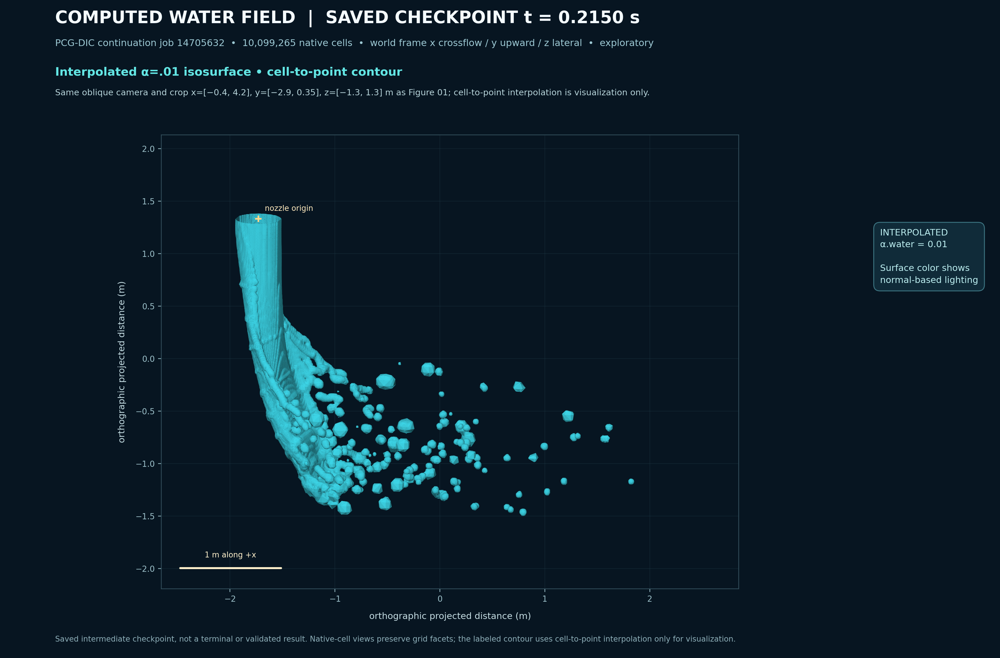

# Rouaix computed-water figure set

Four CPU-rendered views of the saved `t = 0.2150 s` `alpha.water` checkpoint
from the PCG-DIC continuation, Slurm job 14705632. Every image labels this as
an exploratory intermediate checkpoint on the 10,099,265-cell native mesh.
The `.215 s` field was saved and copied while its solver job was still running;
it is not a terminal result or validation evidence.

## Figures

### Oblique near-field surface



Native exterior faces of cells with `alpha.water >= 0.01`, colored by the source
cell value on a logarithmic scale. This view crops to the near field; the full
`alpha >= 0.01` cell-centre support reaches `x = 12.30 m`, as noted in the
figure.

### Native cell facets



The same thresholded native exterior faces, zoomed to show their actual cell
facets. No smoothing, decimation, or interface reconstruction was applied.

### Central native-face cross-section



Each filled polygon is an original native internal face whose vertices lie
exactly in `z = 0 m`. Its color is the original `alpha.water` value in the
adjacent cell with the greater cell-centre `z` coordinate (the `+z` side), and
only faces with that value at least `0.01` are shown. The value is piecewise
constant; no cutter reconstruction or interpolation is used. The full plane has
94,837 native faces and covers 200 m². The shown water support contains 2,848
faces with 0.61456 m² total projected area.

The previous exact-plane `vtkCutter` attempt is superseded: its polygons did
not match the native face topology at this coplanar plane. The corrected PNG is
rendered directly from raw `points`, `faces`, `owner`, and `neighbour` arrays.
The superseded image is retained in ignored run staging with its original hash
in `figure-provenance.json`.

### Interpolated contour alternative



This conventional smooth-looking alternative applies cell-to-point
interpolation to the full mapped checkpoint field and contours at
`alpha.water = 0.01` on the same native volume mesh. Interpolation and normal
lighting are for visualization only. The native-cell figures above remain the
primary geometry-faithful views; the saved solver field and mesh are
unmodified, no geometric smoothing filter was applied, and no droplets were
added.

All four figures show the world frame `x = crossflow`, `y = upward`, `z =
lateral`, the `alpha.water` threshold or contour level, metres or a one-metre
scale reference, and the saved checkpoint time. The 3D views are orthographic
projections built from the actual VTP polygon vertices. Matplotlib Agg created
the PNGs; ParaView Render, OpenGL, and GPU rendering were not used.

## Field identity and checks

The copied rank-collated field SHA-256 is
`687a5e7f395825c85ffdc6fc6a919fbd99c0b7b8f7fee7ec526e70dc9f53c56a`; the
remote size and hash matched before and after transfer. The 120-rank
`cellProcAddressing` map exactly covers all 10,099,265 global cells. The mapped
field integral is `0.2697138634278991 m³`; the solver log reports
`0.269713860359 m³` at the same time, a difference of `3.07e-9 m³` (relative
`1.14e-8`). No alpha values were clipped.

The run is a PCG/DIC pressure-linear-solver sensitivity using the total-pressure
continuation inputs. It remains exploratory; these figures do not validate the
solver or establish an experimental comparison.

- [Field, job, mesh, and retrieval identity](checkpoint-source-receipt.json)
- [Lossless input archive manifest](checkpoint-inputs-manifest.json)
- [Quantitative figure and filter provenance](figure-provenance.json)
- [Native cell identity cross-check](../rouaix_mesh_plate_20261028/vtk-native-cell-identity-crosscheck.json)
- [Figure-generation helpers](source-helpers.tar.gz) and [member hashes](source-helpers-manifest.json)
- [Ignored local input archive](../../runs/rouaix-repro-figures-20261028/staging/checkpoint-inputs-t0215.tar.gz) (95,945,812 bytes; SHA-256 `f94a1bc96d477149659302cb45f0b6858463c1c667ea0dc4ae0d2e9c4f288aa7`)
- [Run record and exact commands](../../runs/rouaix-repro-figures-20261028/README.md)

The lossless archive contains only the `.215 s` `alpha.water`, its exact
120-rank cell map, and the small checkpoint receipt. It is kept in ignored run
staging because it exceeds the 25 MB summary threshold; no full mesh or solver
history is included.
An identical archive is backed up on Komondor under
`/project/nk_meshapplied/bene/fire-track2-hpc/rouaix-repro-figures-source-20261028/`;
its independent remote SHA-256 matches. The exact path and verification time
are in the input manifest, so the selected checkpoint remains recoverable after
the solver's rolling purge.

## Reproducing the views

The commands below use this qualified workspace's recorded mesh/cache paths
and restored helper scripts. The public helper archive preserves the renderer
and mapper sources. Extract the retained source-state archive, map the collated
alpha values to global cell order, then run the renderer. The full renderer now
creates Figure 03 from raw native faces. The separate Figure 03 helper command
produces a reviewable candidate in ignored staging only. The full-renderer integration check was run into a separate staging directory and matched all public PNG hashes:

```sh
tar -xzf results/runs/rouaix-repro-figures-20261028/staging/checkpoint-inputs-t0215.tar.gz -C results/runs/rouaix-repro-figures-20261028/staging

OMP_NUM_THREADS=1 OPENBLAS_NUM_THREADS=1 MKL_NUM_THREADS=1 .venv/bin/python scripts/run_local.py --threads 1 --timeout 600 -- .venv/bin/python results/runs/rouaix-fine-water-view-20261028/map_collated_alpha.py --alpha results/runs/rouaix-repro-figures-20261028/staging/pcg-alpha.water-t0215 --cell-proc-addressing results/runs/rouaix-repro-figures-20261028/staging/pcg-cellProcAddressing --nprocs 120 --expected-cells 10099265 --time-s 0.215 --output-npz results/runs/rouaix-repro-figures-20261028/staging/global-alpha-t0215.npz --output-json results/runs/rouaix-repro-figures-20261028/staging/global-alpha-t0215.json

VTK_SMP_MAX_THREADS=4 OMP_NUM_THREADS=1 OPENBLAS_NUM_THREADS=1 MKL_NUM_THREADS=1 .venv/bin/python scripts/run_local.py --threads 4 --timeout 1200 -- /Applications/ParaView-6.1.1.app/Contents/bin/pvpython results/runs/rouaix-repro-figures-20261028/render_repro_figures.py

# Corrected Figure 03 only (uses the already mapped global alpha and native mesh)
VTK_SMP_MAX_THREADS=4 OMP_NUM_THREADS=1 OPENBLAS_NUM_THREADS=1 MKL_NUM_THREADS=1 .venv/bin/python scripts/run_local.py --threads 4 --timeout 1200 -- /Applications/ParaView-6.1.1.app/Contents/bin/pvpython results/runs/rouaix-repro-figures-20261028/render_native_z0_midplane.py
```

The original renderer reads the already-qualified native mesh and geometry
cache at `results/runs/rouaix-matched-mesh-mac-20261025/final-cast-only-transfer-core`
and `results/runs/rouaix-fine-water-view-20261028/staging`. The corrected
Figure 03 uses `render_native_z0_midplane.py` to read the binary native mesh
faces directly and color the selected `+z` side from the mapped `.215 s` field.
The source-helper archive contains both renderers, the mapper, native mesh
reader/view helper, and geometry extractor; it does not duplicate the mesh or
checkpoint payloads.
